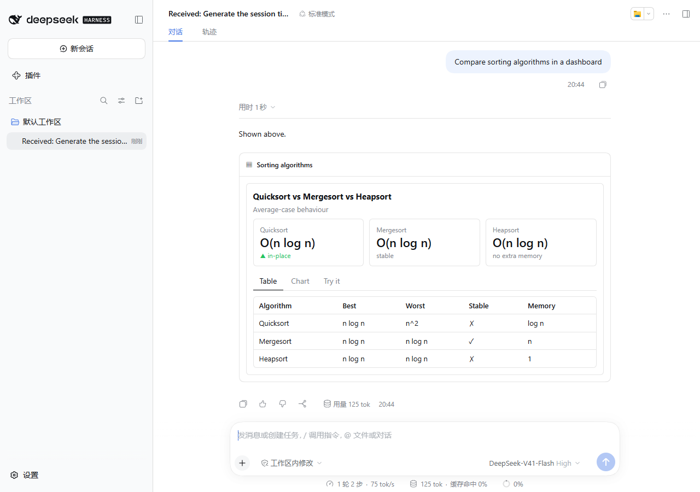
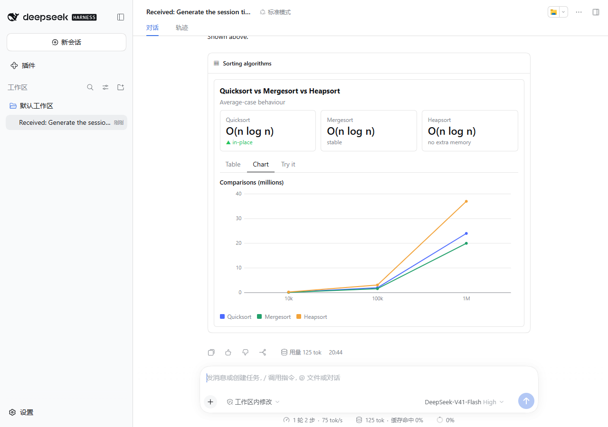
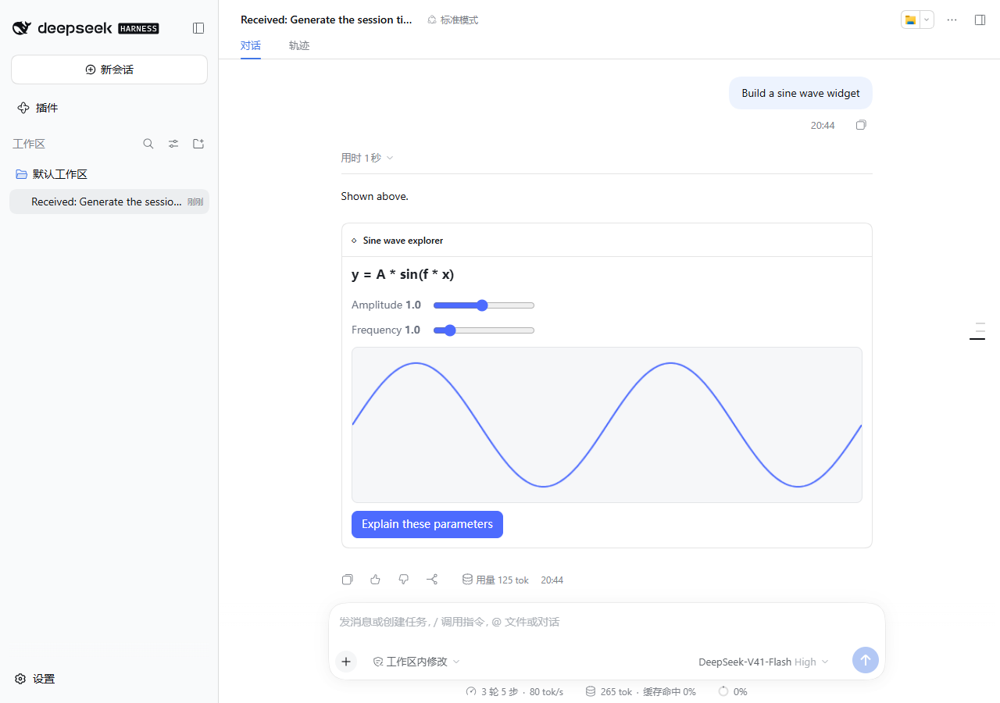
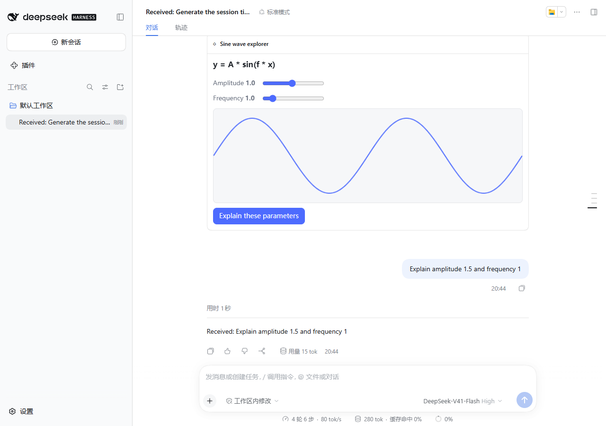

# DeepSeek Harness Intelligent UI（智能界面）

[English](README.md) | 中文

为 [DeepSeek Harness](https://github.com/deepseek-ai/deepseek-harness)（DSH）提供**生成式、可交互的 UI**。模型可以直接在对话中，用卡片、表格、图表、KPI、标签页、按钮、表单作答，也可以生成完全自定义的**沙箱实时组件**。界面随回答流式渲染；用户的点击和表单提交会作为下一条用户消息回到对话中。

本插件把 CopilotKit [OpenIntelligentUI](https://github.com/CopilotKit/OpenIntelligentUI) 的思路（Open Generative UI 加上 A2UI 风格的声明式组件）移植到 DSH 自带的扩展点上，不依赖 CopilotKit、LangGraph 或外部路由服务。

## 演示动画与视频

### 完整交互演练动图


> 🎥 **高清演示视频文件：** [docs/assets/demo.mp4](docs/assets/demo.mp4) (H.264 MP4 格式，支持下载或直接播放)

### 分步界面展示

| 1. 流式声明式看板 | 2. 主题化矢量图表 |
|:---:|:---:|
|  |  |
| *包含 Card、Grid、Stat 指标、Tabs、可排序列的 Table* | *原生 SVG 绘制的多系列对比曲线图* |

| 3. 可交互表单提交 | 4. 实时沙箱小部件 |
|:---:|:---:|
|  |  |
| *表单字段值回流至 LLM 会话上下文* | *独立 iframe，含动态滑块、Canvas 与主题样式* |

| 5. 小部件双向通信 Bridge | 6. 会话持久化与刷新重建 |
|:---:|:---:|
|  |  |
| *`Bridge.sendPrompt` 实时联动发送用户指令* | *刷新页面后无损从持久日志中恢复生成式组件* |

## 模型可用的能力

| 工具 | 适用场景 | 渲染方式 |
|---|---|---|
| `ui_render` | 结构化回答：对比、数据、看板、选项、收集输入 | 固定组件目录中的原生 React 组件，随 JSON 流式输出渐进渲染 |
| `ui_render_widget` | 自定义可视化：模拟、动画、图解、计算器、3D | HTML/CSS/JS 运行在不同源的沙箱 iframe 中：先应用 CSS，HTML 实时 morph，最后执行 JS |

- **命令：** `/ui <想展示的内容>` 让当前对话的模型用 UI 作答。
- **系统提示：** 插件会注入一段说明，告诉模型何时用文本、组件目录或 widget。它取代了 OpenIntelligentUI 的外部路由。

### 组件目录（`ui_render`）

`Card`、`Stack`、`Grid`、`Tabs`、`Text`（markdown 子集）、`Code`、`Alert`、`Badge`、`Divider`、`Stat`、`Progress`、`List`、`Table`（可排序）、`Chart`（柱状图、折线图、面积图、饼图；SVG 绘制，跟随主题）、`Button`（点击后发送一条消息）、`Form`（文本、数字、下拉、勾选、日期、多行文本；提交后把字段值作为消息发送）。

DSH 的工具 schema 不支持递归，所以界面以**扁平节点列表加 id 引用**的形式传输。Host 端会先校验再确认，检查项包括：未知类型或属性、id 悬空或重复、环、一个节点有多个父节点、图表数据长度不一致等。发现问题时返回 `ok:false` 并附带出错路径，模型据此修正后重试。

### 沙箱组件（`ui_render_widget`）

字段遵循 OpenIntelligentUI 的流式约定，**顺序固定**：`title`、`initialHeight`、`placeholderMessages`、`css`、`html`、`jsFunctions`、`jsExpressions`。渲染过程：

1. `css` 完成前，显示占位文字。
2. `css` 完成后，打开预览 iframe，把清洗过的部分 HTML 用 idiomorph 实时 morph 进去。
3. 参数完整后重建 iframe：`jsFunctions` 执行一次，`jsExpressions` 按顺序逐条执行。

组件内可以使用：

- `Bridge.sendPrompt({ text })` 和 `Bridge.openLink({ url })`；为兼容 OpenIntelligentUI，`Websandbox.connection.remote.*` 同样可用。
- `--ui-*` 主题变量，跟随 DSH 的明暗主题。
- 通过 importmap 从 esm.sh 引入的 `three`、`d3`、`chart.js/auto`、`gsap`、`canvas-confetti`。

### 显示位置

回合进行中，UI 在工具调用中内联显示并流式更新。回合结束后，DSH 会把工具调用折叠进「用时 N 秒」的过程区。为了不让界面被折叠，插件通过 `conversation.chat.turnTail` 插槽，把成功的 UI **重新显示在回复下方**，内联处改为一行提示。两者都从持久化的会话日志推导，刷新页面后可以完整重建。

## 安全模型

- **隔离：** iframe 设置 `sandbox="allow-scripts allow-forms"` 并使用 `srcdoc`，**不加** `allow-same-origin`，因此组件无法访问 DSH 页面、cookie、存储或 API。
- **CSP：**
  - `default-src 'none'`
  - 脚本、样式、字体、图片只能来自 `cdnAllowlist`
  - 默认 `connect-src 'none'`
  - `form-action 'none'`
- **消息校验：** 宿主只接受来自该 iframe 的 `contentWindow`、且带有随机 token 的消息。
- **sendPrompt 限制：**
  - 挂载后 1 秒内拒绝发送，防止加载时自动发送
  - 2 秒内最多发送一次
  - 长度受 `sendPromptMaxChars` 限制
  - 以普通的排队用户消息发送
- **openLink：** 只允许 https，并可用白名单进一步限制。

## 安装

需要 DeepSeek Harness `0.2.0-rc.1`，Node ≥ 22.13。

```sh
dsh plugin --profile web add file:/path/to/deepseek-harness-intelligent-ui
```

安装后重启 DSH Web。bundle patch 会自动插入 `intelligent-ui` 这一行；要修改配置，在 profile 的 `cordis.patch.yml` 中添加 `- id: intelligent-ui` 和对应的 `config:`。配置项见英文 README 的表格。

## 开发

```sh
npm install && npm run build && npm test
```

端到端测试使用脚本化的 DeepSeek Messages mock 服务，配合真实的 DSH Web 和真实的 DeepSeek 流式适配器，不需要 API Key。步骤见英文 README。

## 致谢

概念、流式组件协议和部分提示词来自 [CopilotKit/OpenIntelligentUI](https://github.com/CopilotKit/OpenIntelligentUI)（MIT 许可）。本项目采用 MIT 许可。
