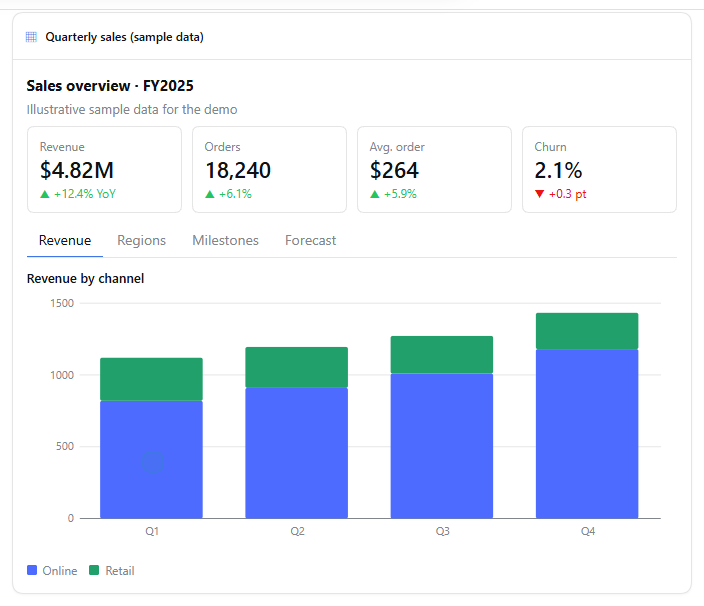
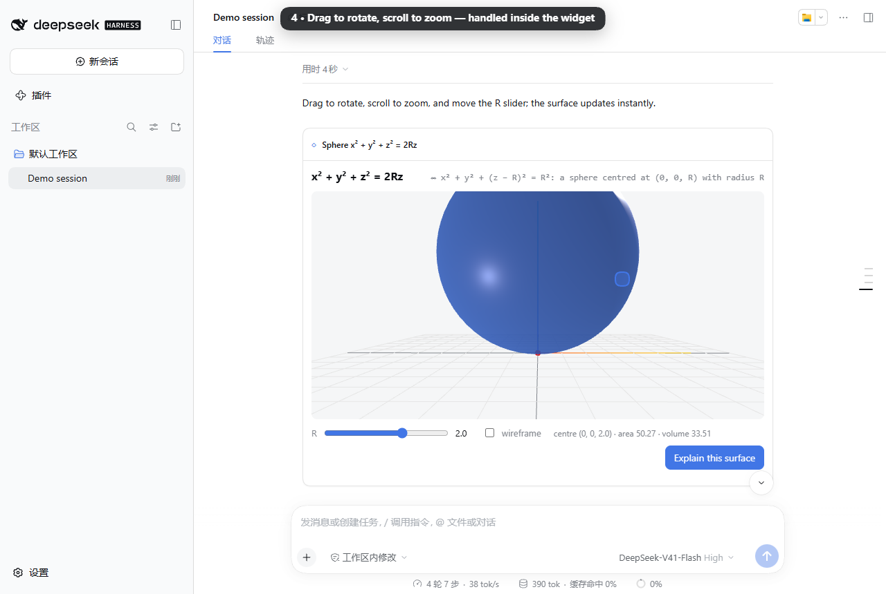
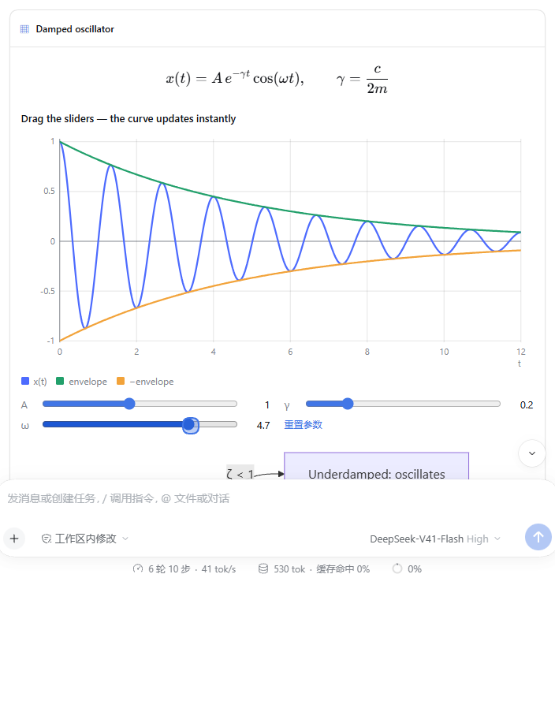
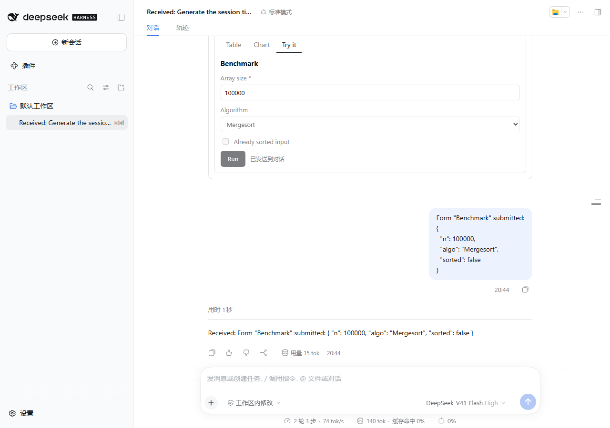
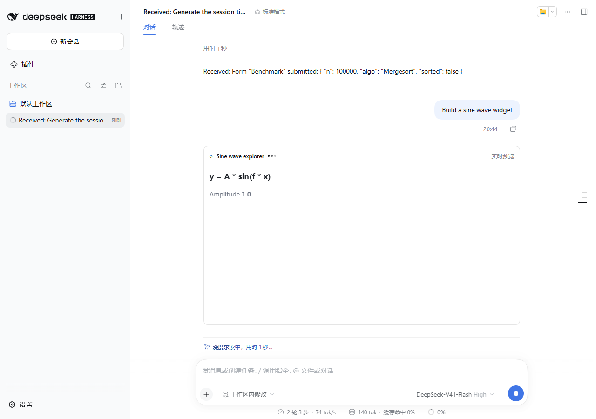
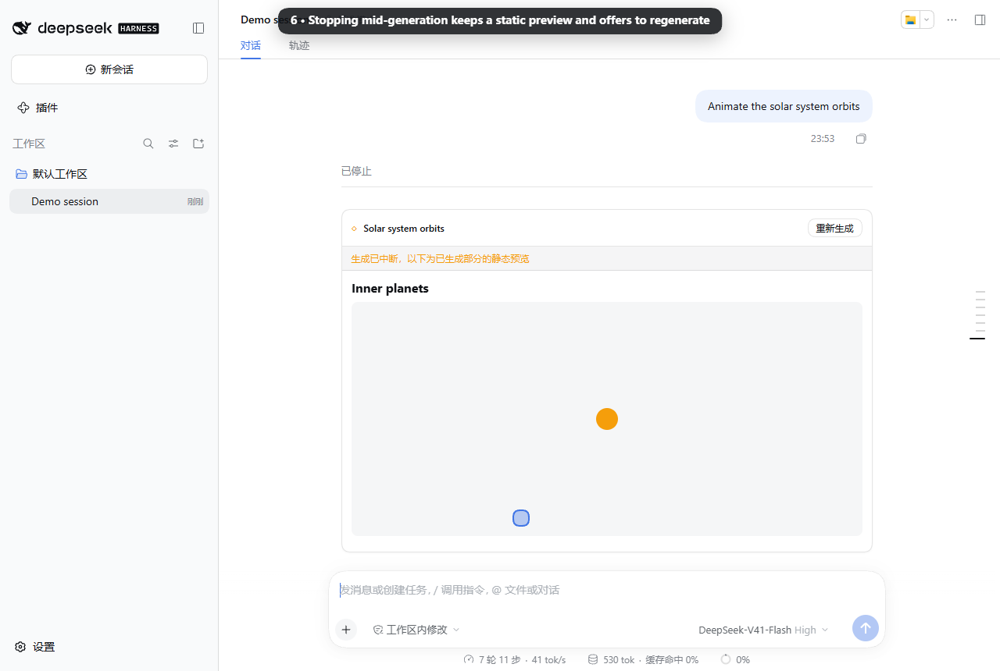
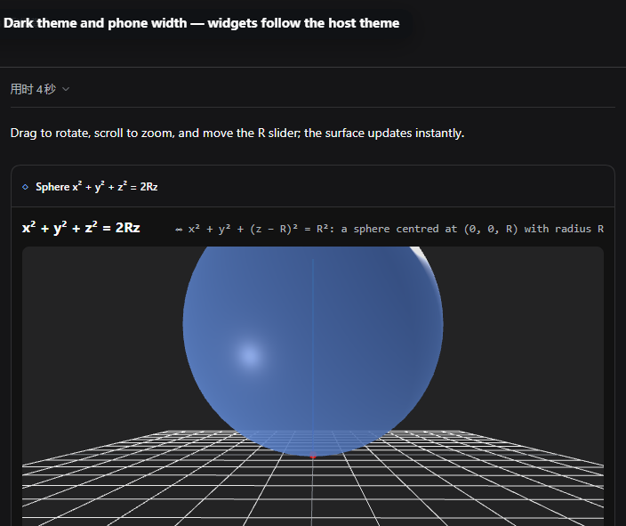
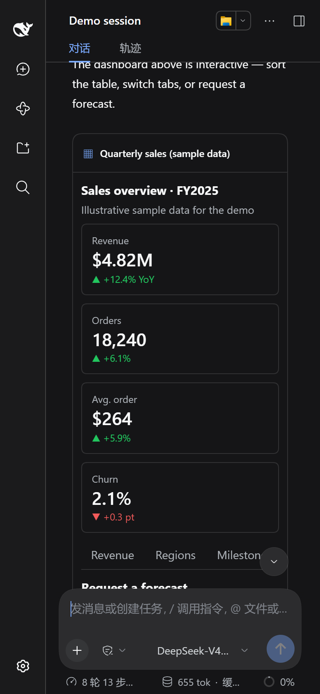
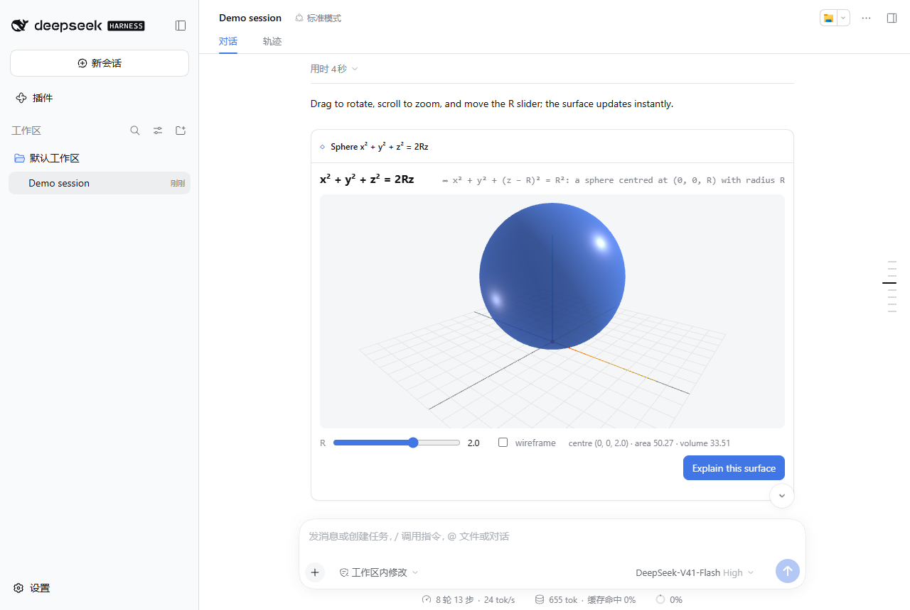

# DeepSeek Harness Intelligent UI（智能界面）

[English](README.md) | 中文

[](https://github.com/dreamfarer-space/deepseek-harness-intelligent-ui/actions/workflows/ci.yml) [](https://www.npmjs.com/package/deepseek-harness-intelligent-ui)

为 [DeepSeek Harness](https://github.com/deepseek-ai/deepseek-harness)（DSH）提供**生成式、可交互的 UI**。用户用自然语言提问，Agent 自行决定怎样作答：

- 普通文本；
- 原生组件：看板、表格、图表、时间线、带滑块的函数图像、KaTeX 公式、Mermaid 流程图、表单；
- 完全自定义的**沙箱实时组件**：Three.js 三维场景、Canvas 模拟、小应用。

界面随回答流式、渐进地出现。滑块、旋转、缩放、排序、切换标签页都在浏览器内即时响应，只有显式操作（按钮、表单、`Bridge.sendPrompt`）才会回到 Agent。

本插件把 CopilotKit [OpenIntelligentUI](https://github.com/CopilotKit/OpenIntelligentUI) 的思路（Open Generative UI + A2UI 风格声明式组件）移植到 DSH 自带的扩展点上，不依赖 CopilotKit、LangGraph 或外部路由服务。

## 演示


🎥 **高清视频（H.264，约 2 分钟）：** [docs/assets/demo.mp4](docs/assets/demo.mp4)

> **录制方式：** 演示视频录自真实的 DSH Web 0.2.0-rc.1，装好本插件后由 `npm run e2e:all -- --record` 自动驱动。
>
> **关于模型：** 背后的模型是 `scripts/e2e/` 中的**脚本化 mock**（当时没有 API Key），回答内容是预设的。画面中的流式渲染、交互、双向通信、持久化和隔离，都是插件在 DSH 中真实运行的结果。
>
> **在 GitHub 内联播放：** 把 `docs/assets/demo.mp4` 拖进 GitHub 的评论或 Release 编辑框，再把生成的 `https://github.com/user-attachments/assets/…` 链接单独一行粘贴到这里。GitHub 只对上传的附件内联播放视频，不支持仓库内的文件。

| 看板流式出现并定稿 | Three.js 组件：R 滑块、旋转、缩放 |
|:---:|:---:|
|  |  |
| *指标卡、栅格、标签页、带悬停提示的堆叠柱状图、可排序表格、时间线、表单* | *用 `UI.three()` 绘制 `x²+y²+z²=2Rz`，拖动滑块在本地即时改变曲面* |

| 公式、实时函数图像、Mermaid | 表单 → Agent → 新界面 |
|:---:|:---:|
|  |  |

| 流式预览（同一个 iframe 直接定稿） | 生成中途停止 |
|:---:|:---:|
|  |  |

| 深色主题 | 手机宽度（深色） | 刷新后恢复 |
|:---:|:---:|:---:|
|  |  |  |

## Agent 如何选择呈现方式

插件注入一段系统提示（`src/guidance.js`），让模型每一轮自行选择，用户无需输入任何命令：

- **普通文本**：寒暄、简短事实、解释说明、要复制的代码、工作区内的编程任务。
- **`ui_render`**：结构化内容，例如对比、数据、看板、流程、公式、可调参数的函数、选项、收集输入。
- **`ui_render_widget`**：用户想探索、操作或观察组件目录画不出的东西，例如三维、模拟、动画、游戏、自定义工具。
- **本地优先**：凡是能在浏览器里算出来的（滑块、旋转、缩放、筛选、排序、重新计算），都必须即时更新，不调用模型。

`/ui <需求>` 命令仍然保留，用于强制以 UI 作答。

## 组件目录（`ui_render`）

| 类别 | 组件 |
|---|---|
| 布局 | `Card`、`Stack`、`Grid`、`Tabs`（支持键盘操作） |
| 文本与提示 | `Text`（markdown 子集）、`Code`、`Alert`、`Badge`、`Divider` |
| 数据 | `Stat`、`Progress`、`List`、`Table`（可排序）、`Timeline` |
| 图表 | `Chart`（柱状、折线、面积、饼图；可堆叠，悬停提示，可点图例显隐系列） |
| 数学与图示 | **`Plot`**、**`Math`**（KaTeX）、**`Mermaid`** |
| 交互 | `Button`、`Form` |

- **`Plot`**：绘制 y = f(x)，参数滑块拖动后曲线即时重绘。表达式由安全编译器解析，不使用 `eval`。
- **`Form`**：字段类型有文本、数字、**范围滑块**、下拉、勾选、日期、多行文本。
- **`Button` 与 `Form`**：点击或提交后，内容作为下一条用户消息发给 Agent。

**传输与校验：** DSH 的工具 schema 不支持递归，所以界面以**扁平节点列表加 id 引用**的形式传输。Host 先校验再确认，检查项包括：

- 未知类型或属性；
- id 悬空、重复或成环；
- 一个节点有多个父节点；
- 图表数据长度不一致；
- `Plot` 表达式无法编译、参数默认值越界等。

发现问题时返回 `ok:false` 并附带出错路径，模型据此修正后重试。

**`Math` 与 `Mermaid` 的渲染：** 两者在与组件相同的沙箱中，从 CDN 白名单加载 KaTeX 或 Mermaid。第三方代码不在 DSH 页面中运行，宿主包体积保持在约 127 KB。CDN 不可用时，显示源码文本。

## 沙箱组件（`ui_render_widget`）

字段顺序固定：`title`、`initialHeight`、`placeholderMessages`、`css`、`html`、`jsFunctions`、`jsExpressions`。

- **流式过程：**
  1. `css` 完成前，显示占位文字。
  2. `css` 完成后打开预览 iframe，把清洗过的部分 HTML 实时 morph 进去。
  3. 参数完整后，在**同一个 iframe 内原地定稿**：morph 最终 HTML，然后执行代码。iframe 不重建，没有白屏闪烁，高度也不跳动。
- **运行时辅助（全局 `UI`）：**
  - `UI.three(el, opts)`：返回 renderer、场景、灯光和 OrbitControls（拖动旋转，滚轮或双指缩放），按需渲染并自适应尺寸。
  - `UI.canvas(el, draw)`：高清 2D 画布，尺寸或主题变化时自动重绘。
  - `UI.state` / `UI.setState()`：持久化状态；带 `id` 的输入控件会自动保存并恢复。
  - `UI.color('accent')`：返回不透明的主题色，可直接用于 three.js 和 Canvas。
  - `UI.onTheme(cb)`、`UI.scheme`、`UI.reducedMotion`：响应主题变化与减少动效偏好。
  - 辅助样式类：`.ui-row`、`.ui-control`、`.ui-card`、`.ui-stage`。
- **Bridge：**
  - `Bridge.sendPrompt({ text })`：在宿主应答前，自动禁用触发它的按钮，防止重复提交。
  - `Bridge.openLink({ url })`：打开链接。
  - `Websandbox.connection.remote.*`：为兼容 OpenIntelligentUI 而保留。
- **依赖库：** 通过 importmap 从 esm.sh 引入 `three`、`three/addons/…`、`d3`、`chart.js/auto`、`gsap`、`canvas-confetti`。
- **错误恢复：** 出现脚本错误时显示错误数量，并提供“重新加载”和“让模型修复”两个按钮。后者会把错误信息发给 Agent。

## 显示位置与状态保持

- **显示位置：**
  - 回合进行中，UI 在工具调用处内联显示。从准备、执行到结果，始终是同一个组件实例，交互状态不会丢。
  - 回合结束后，插件通过 `conversation.chat.turnTail` 把 UI **重新显示在回复下方**，内联处改为一行提示。
- **按工具调用保存的交互状态：** 当前标签页、表格排序、表单值、已提交锁定、Plot 滑块、组件控件值、`UI.state`、iframe 高度。这些状态保存在内存和 `localStorage` 中（有容量上限），移到回复下方或刷新页面后都会恢复。UI 本身则从持久化的会话日志重建。
- **中途停止：**
  - 已进入会话日志的调用：保留已完成的部分（组件的静态预览，或已生成的组件），并显示提示和“重新生成”按钮。
  - 参数仍在流式输出时就被停止的调用：DSH 会整体丢弃它。插件会暂存已生成的内容，同样在被停止的回合下方显示。

## 安全模型

- **隔离：**
  - iframe 设置 `sandbox="allow-scripts allow-forms"` 并使用 `srcdoc`，**不加** `allow-same-origin`。
  - E2E 在浏览器中实测：访问 `parent.document`、`localStorage`、`cookie` 均抛出 `SecurityError`，`fetch` 被拦截，`window.origin` 为 `"null"`。
- **CSP：**
  - `default-src 'none'`；
  - 脚本、样式、字体、图片只能来自 `cdnAllowlist`；
  - 默认 `connect-src 'none'`；
  - `form-action 'none'`、`base-uri 'none'`。
- **消息校验：**
  - 宿主只接受来自该 iframe 的 `contentWindow`、带随机 token、且格式合法的消息。
  - 持久化的组件状态是有大小上限的 JSON。
  - E2E 实测，从页面或 iframe 伪造的消息都会被丢弃。
- **sendPrompt 限制：**
  - 挂载后 1 秒内拒绝发送；
  - 2 秒内最多发送一次；
  - 长度受 `sendPromptMaxChars` 限制；
  - 以普通的排队用户消息发送。
- **openLink：** 只允许 https，可用白名单进一步限制。
- **Plot 表达式：** 由分词器和解析器编译，只能调用固定的数学函数表，无法使用 `eval`、`Function` 或访问属性。

## 安装

需要 [DeepSeek Harness](https://github.com/deepseek-ai/deepseek-harness) **0.1.7 – 0.2.x**（`>=0.1.7-rc.1 <0.3.0`）和 Node.js ≥ 22.13，Windows、Linux、macOS 均可。安装过程不需要编译：npm 包自带预构建的浏览器端 bundle，也没有任何安装脚本。

```sh
dsh plugin --profile web add deepseek-harness-intelligent-ui
```

也可以用引导式安装器。它会先检查 Node、`dsh` 版本、pnpm 和 profile，检查通过后执行同样的 `dsh plugin add`：

```sh
npx deepseek-harness-intelligent-ui install            # 可选 --profile <名称>、--dsh <路径>、--dry-run
npx deepseek-harness-intelligent-ui doctor             # 只诊断，不做修改
```

| 操作 | 命令 |
|---|---|
| 升级 | `dsh plugin --profile web add deepseek-harness-intelligent-ui@latest` |
| 试用预发布版 | `dsh plugin --profile web add deepseek-harness-intelligent-ui@next` |
| 固定版本 | `dsh plugin --profile web add deepseek-harness-intelligent-ui@0.2.0` |
| 卸载 | `dsh plugin --profile web remove deepseek-harness-intelligent-ui`（或 `npx deepseek-harness-intelligent-ui uninstall`） |
| 从源码目录安装 | `dsh plugin --profile web add file:/path/to/deepseek-harness-intelligent-ui` |

安装后需要重启 DSH Web。bundle patch 会自动插入 `intelligent-ui` 这一行。要修改配置，在 profile 的 `cordis.patch.yml` 中添加 `- id: intelligent-ui` 和对应的 `config:`，配置项见英文 README 的表格。支持的 DSH 版本和 CI 测试矩阵见 [docs/compatibility.md](docs/compatibility.md)。

**常见问题**

- *提示 `pnpm was not found`*：DSH 用 pnpm 安装插件。运行 `corepack enable`（Node 自带）或 `npm i -g pnpm`。
- *提示 `… is incompatible with dsh X`*：当前 DSH 版本不在支持范围内。可以升级 DSH（`npm i -g @deepseek-ai/dsh@latest`），或在[兼容性文档](docs/compatibility.md)里找支持该版本的插件发行版。
- *从 0.1.x 升级（以前用 `file:` 安装的 `dsh-intelligent-ui`）*：先运行 `dsh plugin --profile web remove dsh-intelligent-ui`。新旧两个包会插入同一个 `intelligent-ui` 行，`doctor` 能检测到这种冲突。
- *界面没有出现*：安装后要重启 DSH Web，并确认启动的是安装插件时指定的 profile（`dsh web`）。

## 开发与验证

```sh
npm install
npm run build
npm test                      # 107 个单元/组件测试（含 DSH 兼容性检查与安装器 CLI）
npm run typecheck
npm run e2e:all               # 构建 → 安装到临时 DSH 目录 → mock 模型 + 真实 DSH Web → 24 项浏览器检查
npm run e2e:all -- --record   # 同时重新录制 docs/assets/demo.mp4 / demo.gif（需要 ffmpeg）
npm run e2e:all -- --spec ./deepseek-harness-intelligent-ui-<版本>.tgz   # 改为对 npm pack 打出的包做 E2E
npm run smoke -- --spec ./deepseek-harness-intelligent-ui-<版本>.tgz     # 安装冒烟测试（不需要浏览器）
```

E2E 可以在 Windows、Linux、macOS 上运行。它会按平台自动查找 Chrome（可用 `CHROME_PATH` 指定），`DSH_BIN` 可指定其他 `dsh` 可执行文件。检查项见 `scripts/e2e/browser.mjs`，最近一次报告在 [`docs/e2e-report.json`](docs/e2e-report.json)。GitHub Actions 会在三个系统上，针对每个受支持的 DSH 版本跑完全部测试。

`client/client.js` 已提交到仓库并随包发布，所以 npm、`file:` 和 git 安装都不需要构建。不要添加 `prepare` 或 `postinstall` 脚本，因为 DSH 使用的 pnpm 会拦截插件的构建脚本。

**发布流程**（维护者）：

1. 在 [CHANGELOG.md](CHANGELOG.md) 中新增 `## [x.y.z]` 小节。
2. 运行 `npm version x.y.z`（或 `npm version prerelease --preid rc`）。这一步会用新版本号重新构建 `client/client.js` 并打 tag。
3. 运行 `git push --follow-tags`。tag 推送后，Release 工作流会依次执行：
   - 运行完整的 CI 矩阵；
   - 带 provenance 发布到 npm（预发布版使用 `next` 标签）；
   - 在三个系统上对已发布的包做冒烟测试；
   - 用 CHANGELOG 的对应小节和 tarball 创建 GitHub Release。
4. 本地可以先运行 `npm run release:check` 做同样的预检。

## 真实模型路由与生成质量实测

本插件的自主路由引导词与 UI 生成能力已直连官方 DeepSeek API（`deepseek-flash` 模型）完成全方位质量实测，共评估 15 个自然语言测试用例，覆盖 4 大核心类别（详细数据见 [`docs/real-model-eval-report.json`](docs/real-model-eval-report.json)）：

- **A. 普通文本问答（4/4 PASS，通过率 100%）：** 包含欧拉公式定义、卡尔曼滤波原理解释、牛顿第三定律、机械臂奇异点概念。模型主动输出清晰纯文本，不滥用 UI，不产生多余卡片。
- **B. 原生组件生成（5/5 PASS，通过率 100%）：** 包含多指标运营看板（24+ 原生组件组合）、新能源车对比可排列表格、季度多系列柱状图、满意度反馈交互表单、具身智能技术时间线。模型均**自主选择 `ui_render`**，组件树校验 `validateTree` 100% 合法。
- **C. 自定义沙箱组件（4/4 PASS，通过率 100%）：** 包含三维球面 $x^2+y^2+z^2=2Rz$、阻尼振动滑块曲线、Three.js 交互式太阳系、单摆物理模拟器。模型均**自主选择 `ui_render_widget`**，HTML/CSS/JS 沙箱参数校验 `validateWidget` 全部通过。
- **D. 多轮交互推理（2/2 PASS，通过率 100%）：** 验证表单提交数据后 Agent 能够继续结合参数进行推演，以及多轮修改表格时保留上下文与增量修改。

```sh
node scripts/run-real-model-suite.mjs [A|B|C|D|all]   # 运行真实模型测试套件（读取 DEEPSEEK_API_KEY）
```

## 已知限制

- 沙箱组件、`Math` 和 `Mermaid` 需要能访问 CDN 白名单。离线时，`Math` 和 `Mermaid` 退回显示源码，`UI.three` 会报告脚本错误。
- 交互状态保存在当前浏览器的 `localStorage` 中，不跨设备同步。
- 对“流式中途被丢弃的调用”，插件按回合的起止时间归属。如果远程 DSH 主机与浏览器的时钟偏差较大，这张卡片可能不显示。已进入会话日志的调用不受影响。

## 致谢

概念、流式组件协议和部分提示词来自 [CopilotKit/OpenIntelligentUI](https://github.com/CopilotKit/OpenIntelligentUI)（MIT 许可）。本项目采用 MIT 许可。
